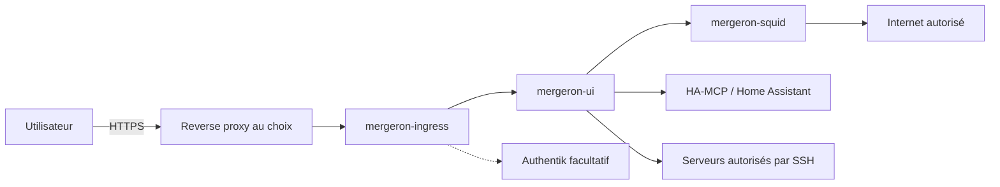

# Mergeron

Mergeron est un espace collaboratif auto-hébergé pour piloter les projets,
les conversations, les documents et les agents de développement. Il s’installe
sur un hôte Docker Linux avec Compose ou Mergeron Manager. Codex est le moteur de
développement actuellement intégré, pas le nom de la plateforme.

L’icône graphite-cuivre est commune au web et à la PWA. Son original vectoriel
se trouve dans [`web/public/mergeron-icon.svg`](web/public/mergeron-icon.svg).
L’image officielle est `ghcr.io/maxhugit/mergeron:latest` et le gestionnaire local
est d'abord publié sous `ghcr.io/maxhugit/mergeron-manager:edge` ; son tag
`latest` est créé avec une version stable. Les conteneurs
applicatifs sont nommés `mergeron-ui`, `mergeron-ingress` et `mergeron-squid` ;
`mergeron-manager` peut créer les ressources manquantes après validation d'un
plan non destructif, puis surveiller et mettre à jour la pile avec sauvegarde
et retour arrière. Les variables de
configuration, volumes et clés de stockage existants sont conservés.
La [migration vers Mergeron](docs/migration-mergeron.md) décrit les changements
à reporter dans une installation Docker existante.

Il s’agit d’une adaptation du projet
[`LimLLL/mergeron`](https://github.com/LimLLL/mergeron), publiée sous
licence AGPL-3.0-or-later.

## Fonctions principales

- projets avec participants, espace de travail, espace système séparé réservé
  aux administrateurs, connaissances et connecteurs dédiés ;
- conversations Codex regroupées par projet et espace de travail ;
- chat simple utilisant directement l’API OpenAI ;
- tableaux de tâches, planning, sous-tâches et agents Codex ;
- livrables documentaires versionnés, validables et rattachés aux tâches ;
- gestion des personnes, chef de projet et groupes internes au projet ;
- automatisations rattachées aux projets ;
- terminaux persistants ;
- navigation et modification des fichiers de `/workspaces` et `/appdata` ;
- Git local et GitHub distincts, préparation des commits, comparaison des
  fichiers et graphe des branches dans des onglets de conversation ;
- prévisualisations web isolées par agent, autorisées par projet, avec URL
  HTTPS, outils MCP et synchronisation des sources ;
- navigateur distant intégré et extension locale Chrome, Edge ou Safari sur
  Mac, conservés comme deux modes explicitement sélectionnables ;
- consultation des PDF et édition des documents Office avec OnlyOffice ;
- intégrations MCP, notamment Home Assistant ;
- isolation des données selon le rôle et la participation aux projets ;
- accès SSH aux serveurs autorisés avec des clés montées en lecture seule ;
- interface adaptée aux ordinateurs et aux mobiles/PWA.

## Architecture de production

La pile de base utilise trois conteneurs applicatifs et un gestionnaire local :

1. `mergeron-ui` exécute l’interface, le backend et le moteur Codex ;
2. `mergeron-ingress` protège et transmet les requêtes entrantes ;
3. `mergeron-squid` filtre les accès HTTP/HTTPS sortants.
4. `mergeron-manager` installe les ressources déclarées, lit leur état Docker et
   expose son diagnostic par socket Unix, réalise les mises à jour
   transactionnelles et gère les runtimes autorisés.

Le navigateur distant `mergeron-browser` est facultatif et activé explicitement.
Les prévisualisations ajoutent des ressources jetables isolées, pas un accès
Docker dans les agents. Le CLI personnalisé et protégé s’installe par le Manager ;
voir le [runtime Codex géré](docs/operations/managed-codex-runtime.md).



La définition Docker Compose standard se trouve dans
[`deployment/compose.yml`](deployment/compose.yml). Les intégrations aux panneaux
d’administration hôtes sont des [adaptations facultatives](docs/adapters/README.md).
Les détails des réseaux et des protections sont documentés dans
[`docs/architecture.md`](docs/architecture.md).
Le fonctionnement du gestionnaire local est décrit dans
[`docs/mergeron-manager.md`](docs/mergeron-manager.md).

## Reconstruire la plateforme

Le [sommaire de la documentation](docs/README.md) permet de comprendre le dépôt
et de reconstruire toute la plateforme. Commencer par
[l’installation portable](docs/installation-portable.md) : réseau configurable,
chemins de l’hôte au choix, Traefik/Caddy/Nginx Proxy Manager, authentification
native ou Authentik. Aucun réseau personnel ni nom de pool n’est imposé. Le
[comparatif des modes d’installation](docs/choisir-mode-installation.md) explique
les différences de gestion des réseaux, mises à jour et retours arrière. La
[procédure Docker](docs/installation-docker.md) couvre la préparation des secrets
et les démarrages avec Manager ou Compose. Les adaptations aux interfaces
d’administration ne sont pas nécessaires au fonctionnement de la pile.

## Construction et versions de l’image

Mergeron reste en version majeure `0` pendant sa phase actuelle. Les versions
stables suivent donc le format `0.x.y`.

Chaque modification de la branche `main` construit et publie une image continue :

```text
ghcr.io/maxhugit/mergeron:edge
ghcr.io/maxhugit/mergeron:sha-<commit>
ghcr.io/maxhugit/mergeron-manager:edge
ghcr.io/maxhugit/mergeron-manager:sha-<commit>
ghcr.io/maxhugit/mergeron-browser:edge
ghcr.io/maxhugit/mergeron-browser:sha-<commit>
```

Un tag Git `v0.x.y`, identique aux versions des deux `package.json`, publie
ensuite la version stable sous `0.x.y`, `0.x` et `latest`. La GitHub Release et
ses notes cumulées sont créées uniquement après validation et promotion de
l’image. La [procédure de publication](docs/publications.md) décrit le cycle
complet.

Les guides décrivent l’état courant de `main`/`edge`. Une nouveauté fusionnée
après la dernière version stable nécessite cette image continue ou une prochaine
publication stable ; le numéro de version applicatif ne suffit pas à identifier
une révision continue.

Pour la production, un tag immuable `0.x.y` ou `sha-...` est préférable à
`latest`.

Le registre conserve automatiquement les 10 images les plus récentes portant
uniquement un tag `sha-*`. Les tags `latest`, `edge`, `buildcache` et les tags
de version sont protégés. Le nettoyage est exécuté chaque semaine et peut être
lancé manuellement en mode simulation depuis GitHub Actions.

## Évolutions du projet d’origine

La synchronisation automatique avec le projet d’origine est désactivée. Ce fork
contient désormais des adaptations importantes pour Docker, le mobile, les
fichiers, OnlyOffice, Authentik et la sécurité réseau. Une fusion globale de
l’amont présenterait trop de risques de régression.

Une évolution utile doit être reprise manuellement dans une branche dédiée,
avec lecture du diff, tests et validation avant intégration.

## Données exclues du dépôt

Ne jamais ajouter à Git les clés OpenAI, clés privées SSH, jetons internes,
identifiants OAuth/MCP, bases SQLite, conversations, espaces de travail ou
contenus d’`appdata`.

Consulter [`SECURITY.md`](SECURITY.md) avant toute modification du déploiement.
