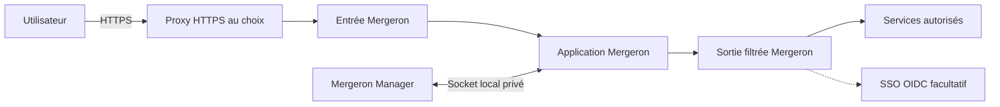

# Mergeron

Mergeron est une plateforme collaborative auto-hébergée pour les projets,
les conversations, les agents et les documents. Elle s’installe sur un hôte
Docker Linux **uniquement par Mergeron Manager**. Aucun NAS, proxy HTTPS ou
fournisseur SSO particulier n’est imposé.

## Installer

Suivre [Installer Mergeron](docs/installation.md) : préparer l’hôte, configurer
et démarrer le Manager, créer le premier administrateur, puis vérifier l’accès.
Le Manager prépare les données, les secrets et les dépendances ; aucun second
déploiement manuel ou Compose n’est nécessaire.

- [Variables du Manager](docs/variables-manager.md) : défauts, rôle et quand les modifier.
- [Raccordement réseau et SSO facultatif](docs/installation-portable.md).
- [Documentation complète](docs/README.md).

## Fonctionnalités

- projets, participants, droits et espaces de travail séparés ;
- conversations, agents de développement et chat ;
- tâches, planning, sous-tâches et automatisations ;
- livrables et documents versionnés ;
- explorateurs de fichiers et terminaux ;
- dépôts Git, préparation des commits, branches et pull requests ;
- environnements de test isolés et vérification visuelle ;
- navigation web distante ou via une extension locale ;
- intégrations facultatives aux services autorisés ;
- interface ordinateur, mobile et PWA.

Le moteur d’agents actuellement intégré est Codex ; il se configure après
l’installation. Les services externes restent facultatifs selon les fonctions utilisées.

## Architecture



Le Manager installe et gère les composants Mergeron, sans port réseau public.
Votre proxy HTTPS et votre éventuel SSO restent administrés séparément.
Voir l’[architecture](docs/architecture.md) et le [fonctionnement du Manager](docs/mergeron-manager.md).
Les [adaptations aux panneaux hôtes](docs/adapters/README.md) sont facultatives.

## Répertoires du dépôt

Chaque répertoire racine suivi dans Git possède un README qui explique son
objectif fonctionnel, son contenu et ses précautions d’usage.

| Répertoire                           | Objectif fonctionnel                                            |
| ------------------------------------ | --------------------------------------------------------------- |
| [.github](.github/README.md)         | Valider les changements et organiser les publications GitHub.   |
| [codex_probe](codex_probe/README.md) | Vérifier le comportement réel du protocole Codex.               |
| [deployment](deployment/README.md)   | Fournir les modèles d’installation et d’exploitation.           |
| [docs](docs/README.md)               | Expliquer les parcours utilisateur et l’administration.         |
| [drizzle](drizzle/README.md)         | Faire évoluer les données SQLite entre versions.                |
| [images](images/README.md)           | Conserver les captures de référence documentaires.              |
| [manager](manager/README.md)         | Installer et maintenir les composants et prévisualisations.     |
| [runtime](runtime/README.md)         | Partager les contrats du CLI et des environnements exécutés.    |
| [scripts](scripts/README.md)         | Construire, vérifier et maintenir la solution.                  |
| [security](security/README.md)       | Conserver les évaluations et correctifs de sécurité.            |
| [skills](skills/README.md)           | Fournir les méthodes spécialisées des agents.                   |
| [src](src/README.md)                 | Appliquer les règles métier et exposer les services du serveur. |
| [web](web/README.md)                 | Fournir l’interface, la PWA et l’extension navigateur.          |

Les dossiers locaux générés comme `node_modules/`, `dist/` et `public/` à la
racine ne sont pas des sources à maintenir dans Git. Pour les règles de
nettoyage du code et de conservation des tests, voir la
[maintenance du code](docs/maintenance-code.md).

## Construction et versions de l’image

Mergeron reste en version majeure `0` pendant sa phase actuelle. Les versions
stables suivent donc le format `0.x.y`.

Chaque modification de la branche `main` construit et publie une image continue :

```text
ghcr.io/maxhugit/mergeron:edge
ghcr.io/maxhugit/mergeron:sha-<commit>
ghcr.io/maxhugit/mergeron-manager:edge
ghcr.io/maxhugit/mergeron-manager:sha-<commit>
ghcr.io/maxhugit/mergeron-browser:edge
ghcr.io/maxhugit/mergeron-browser:sha-<commit>
```

Un tag Git `v0.x.y`, identique aux versions des deux `package.json`, publie
ensuite la version stable sous `0.x.y`, `0.x` et `latest`. La GitHub Release et
ses notes cumulées sont créées uniquement après validation et promotion de
l’image. La [procédure de publication](docs/publications.md) décrit le cycle
complet.

Les guides décrivent l’état courant de `main`/`edge`. Une nouveauté fusionnée
après la dernière version stable nécessite cette image continue ou une prochaine
publication stable ; le numéro de version applicatif ne suffit pas à identifier
une révision continue.

Pour la production, un tag immuable `0.x.y` ou `sha-...` est préférable à
`latest`.

Le registre conserve automatiquement les 10 images les plus récentes portant
uniquement un tag `sha-*`. Les tags `latest`, `edge`, `buildcache` et les tags
de version sont protégés. Le nettoyage est exécuté chaque semaine et peut être
lancé manuellement en mode simulation depuis GitHub Actions.

## Sécurité et licence

Ne jamais ajouter à Git les mots de passe, clés, jetons, configurations privées,
bases de données, conversations ou espaces de travail.
Consulter la [politique de sécurité](SECURITY.md).

Licence AGPL-3.0-or-later ; les notices du dépôt sont conservées.
