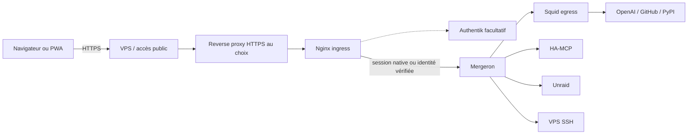

# Architecture Docker de Mergeron

Cette architecture est commune à Linux et Unraid. Les noms de réseaux ci-dessous
sont les valeurs par défaut ; le raccordement extérieur est configurable par
`MERGERON_PROXY_NETWORK`. Voir [l’installation portable](installation-portable.md).

## Vue d’ensemble

## Conteneurs

### `mergeron`

Application principale et moteur Codex. Aucun port n’est publié sur l’hôte.
L’application est joignable uniquement depuis Nginx sur le réseau interne.

Montages persistants :

| Montage            | Usage                                  | Accès            |
| ------------------ | -------------------------------------- | ---------------- |
| `/home/codex`      | configuration, OAuth, MCP, base SQLite | lecture/écriture |
| `/workspaces`      | espaces de travail                     | lecture/écriture |
| `/appdata`         | configurations Unraid                  | lecture/écriture |
| `/app/logs`        | journaux                               | lecture/écriture |
| `/home/codex/.ssh` | clés et configuration SSH              | lecture seule    |
| `/run/secrets/*`   | jetons internes et clé OpenAI          | lecture seule    |

### `mergeron-ingress`

Passerelle Nginx entre le reverse proxy choisi et l’application. En mode
historique, elle contrôle Authentik, renouvelle les cookies et injecte le jeton
interne avec l’identité vérifiée. En mode `native`, elle n’injecte aucun jeton de
service dans les requêtes navigateur : Mergeron vérifie ses sessions locales ou
OIDC. Les en-têtes d’identité du navigateur sont effacés dans ce mode.

Les exceptions machine-à-machine sont limitées au retour OAuth MCP et aux deux
routes OnlyOffice. Les contrôles applicatifs OnlyOffice restent obligatoires.

### `mergeron-squid`

Proxy Squid utilisé par les variables `HTTP_PROXY`, `HTTPS_PROXY` et
`ALL_PROXY`. Il refuse les adresses privées et n’autorise qu’une liste définie
de domaines Internet.

## Réseaux

| Réseau                                      | Type           | Membres                                     | Fonction                            |
| ------------------------------------------- | -------------- | ------------------------------------------- | ----------------------------------- |
| `mergeron-isolated`                         | bridge interne | les trois conteneurs                        | trafic privé entre les composants   |
| `mergeron-external`                         | bridge         | Squid                                       | sortie Internet du proxy            |
| `mergeron-admin`                            | bridge `/28`   | application                                 | SSH, MCP et services administratifs |
| `MERGERON_PROXY_NETWORK` (`mergeron-proxy`) | réseau externe | ingress, proxy choisi, Authentik si utilisé | entrée HTTPS                        |

`mergeron-isolated` possède `internal: true` : il ne fournit pas de route Internet.

## Flux entrant

1. Le reverse proxy choisi termine TLS pour le domaine public.
2. Il transmet à `mergeron-ingress:8080`, jamais au backend.
3. L’ingress contrôle Authentik dans le mode historique ; en mode natif,
   l’application vérifie la session Mergeron/OIDC.
4. Une identité absente ou non autorisée ne donne aucun accès aux API.
5. Le backend reste sur son réseau privé, sans port hôte publié.

## Flux sortant

Les logiciels respectant les variables de proxy passent par Squid. Les domaines
autorisés sont définis dans `deployment/config/squid.conf`.

Le réseau `mergeron-admin` offre une route directe nécessaire aux connexions SSH et
aux services locaux. Il s’agit d’un compromis connu : Squid n’est donc pas un
pare-feu absolu pour un programme qui ignorerait volontairement le proxy.

## Durcissement Docker

- `privileged: false` ;
- aucun socket Docker dans les trois dépendances ; seul le Manager dispose
  de l’API Docker locale, avec les privilèges importants que cela implique ;
- `read_only: true` ;
- `cap_drop: ALL` ;
- `no-new-privileges:true` ;
- ressources CPU, mémoire et PID limitées ;
- répertoires temporaires en `tmpfs` avec `nosuid,nodev` ;
- profil seccomp spécifique pour le bac à sable Bubblewrap ;
- rotation des journaux Docker.
