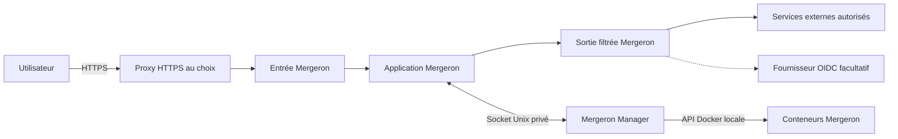

# Architecture de Mergeron

Mergeron s’installe uniquement par son Manager, sur un hôte Docker Linux pris
en charge. Le stockage, le domaine, le proxy HTTPS et le fournisseur SSO
facultatif restent au choix de l’administrateur.

## Vue d’ensemble

Le proxy HTTPS n’est pas le Manager. Le SSO n’est pas obligatoire et aucun
fournisseur particulier n’est requis. Le Manager est local, sans page Web ni
port réseau à exposer.

## Composants livrés

| Composant          | Rôle                                                                                                                                                           |
| ------------------ | -------------------------------------------------------------------------------------------------------------------------------------------------------------- |
| `mergeron-manager` | Installe les ressources déclarées, observe leur santé, contrôle les mises à jour et retours arrière, fournit le CLI validé et orchestre les aperçus autorisés. |
| `mergeron-ui`      | Interface, API, conversations, documents et moteur d’agents. Aucun port hôte publié.                                                                           |
| `mergeron-ingress` | Entrée HTTP/WebSocket entre votre proxy et l’application ; implémentation Nginx fournie avec Mergeron.                                                         |
| `mergeron-squid`   | Filtre les sorties HTTP(S) autorisées ; implémentation Squid fournie avec Mergeron.                                                                            |

Le [navigateur distant](navigateur-annote.md) est facultatif. Chaque
[environnement de test](previsualisations-agents.md) utilise ses propres
ressources jetables, sans compte de production, source hôte ou socket Docker.
L’extension locale utilise, elle, le navigateur de l’utilisateur.

## Données persistantes

| Montage applicatif | Usage                                                                          |
| ------------------ | ------------------------------------------------------------------------------ |
| `/home/codex`      | Configuration, comptes, base SQLite, conversations et configuration du moteur. |
| `/workspaces`      | Espaces de travail, documents et espaces système des projets.                  |
| `/appdata`         | Dossiers hôtes explicitement autorisés ; limiter leur périmètre.               |
| `/app/logs`        | Journaux.                                                                      |
| `/run/secrets/*`   | Secrets internes, montés en lecture seule.                                     |
| `/home/codex/.ssh` | Matériel de connexion facultatif, monté en lecture seule.                      |

La racine hôte est `MERGERON_STATE_ROOT`. Le Manager la retrouve sous
`/host-state`. Son socket et son état privé restent dans `manager-run` et
`manager-state`. Les [sauvegardes externes](sauvegarde-restauration.md) restent
nécessaires, notamment pour les dossiers externes exposés sous `/appdata`.

## Réseaux

| Réseau par défaut        | Membres de base                      | Fonction                                     |
| ------------------------ | ------------------------------------ | -------------------------------------------- |
| `mergeron-isolated`      | Application, ingress, filtre sortant | Échanges privés ; réseau Docker interne.     |
| `mergeron-external`      | Filtre sortant                       | Sorties Internet.                            |
| `mergeron-admin`         | Application                          | Accès aux services autorisés.                |
| `MERGERON_PROXY_NETWORK` | Ingress et proxy choisi              | Raccordement à l’entrée HTTPS ; préexistant. |

Les noms sont préfixés par `MERGERON_STACK_PREFIX`. Le Manager crée seulement
les réseaux de sa pile, jamais le réseau externe du proxy. Il reste lui-même
en `network none`. Les services facultatifs ajoutent leurs réseaux dédiés.

## Frontières de sécurité

- Seul le Manager reçoit le socket Docker. Son montage en lecture seule
  n’enlève pas les privilèges de l’API : cet accès reste réservé à l’administrateur.
- Le proxy cible l’ingress sur 8080, jamais le backend.
- Mergeron vérifie ses sessions locales ou OIDC et efface les en-têtes
  d’identité non fiables ; aucun accès métier anonyme n’est créé.
- Les conteneurs ont une racine en lecture seule, des capacités réduites, des
  limites de ressources, des temporaires séparés et des journaux bornés.
- Le bac à sable interne utilise le profil système livré, pas le mode privilégié.
- Le filtre HTTP(S) n’est pas un pare-feu absolu pour un programme ignorant le
  proxy : le réseau administratif conserve une route vers les services autorisés.

Voir [l’installation](installation.md), les [variables](variables-manager.md)
et la [politique de sécurité](../SECURITY.md).
