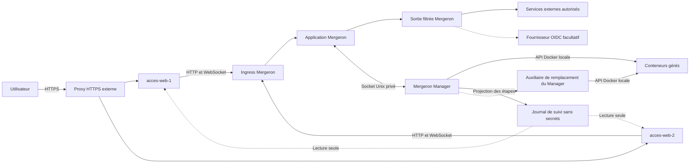

# Architecture de Mergeron

Mergeron s’installe uniquement par son Manager, sur un hôte Docker Linux pris
en charge. Le stockage, le domaine, le proxy HTTPS et le fournisseur SSO
facultatif restent au choix de l’administrateur.

## Vue d’ensemble

Le schéma ci-dessous représente une installation avec le suivi HTTP indépendant
activé. Les deux relais d’accès web fonctionnent **en permanence**, pas seulement
pendant les mises à jour.

Le proxy HTTPS termine TLS et distribue les requêtes aux deux relais équivalents.
Chacun transmet normalement le trafic à l’ingress, qui applique les contrôles
d’accès avant l’application. Les noms complets dépendent de la stack, par exemple
`mergeron-dev-acces-web-1` et `mergeron-dev-acces-web-2`. Les numéros distinguent
des répliques actives, pas un serveur principal et un serveur de secours.

Le proxy HTTPS n’est pas le Manager. Le SSO reste facultatif. Le Manager ne
possède ni page Web ni port réseau exposé : l’interface l’interroge par le backend
applicatif et son socket Unix privé. Le parcours classique sans suivi indépendant
peut raccorder le proxy directement à l’ingress ; l’installation des relais et du
routage continu est une activation explicite sur l’hôte. L’outillage de routage
continu et son intégration au proxy sont décrits dans le
[guide du suivi indépendant](continuous-updates.md).

## Composants livrés

| Composant          | Rôle                                                                                                                                                           |
| ------------------ | -------------------------------------------------------------------------------------------------------------------------------------------------------------- |
| `mergeron-acces-web-1`, `mergeron-acces-web-2` | Relais HTTP permanents et redondants. Transmettent le trafic normal et servent le suivi indépendant pendant les redémarrages. |
| `mergeron-manager` | Installe les ressources déclarées, observe leur santé, contrôle les mises à jour et retours arrière, fournit le CLI validé et orchestre les aperçus autorisés. |
| `mergeron-ui`      | Interface, API, conversations, documents et moteur d’agents. Aucun port hôte publié.                                                                           |
| `mergeron-ingress` | Entrée HTTP/WebSocket entre votre proxy et l’application ; implémentation Nginx fournie avec Mergeron.                                                         |
| `mergeron-squid`   | Filtre les sorties HTTP(S) autorisées ; implémentation Squid fournie avec Mergeron.                                                                            |

Le [navigateur distant](navigateur-annote.md) est facultatif. Chaque
[environnement de test](previsualisations-agents.md) utilise ses propres
ressources jetables, sans compte de production, source hôte ou socket Docker.
L’extension locale utilise, elle, le navigateur de l’utilisateur.

## Données persistantes

| Montage applicatif | Usage                                                                          |
| ------------------ | ------------------------------------------------------------------------------ |
| `/home/codex`      | Configuration, comptes, base SQLite, conversations et configuration du moteur. |
| `/workspaces`      | Espaces de travail, documents et espaces système des projets.                  |
| `/appdata`         | Dossiers hôtes explicitement autorisés ; limiter leur périmètre.               |
| `/app/logs`        | Journaux.                                                                      |
| `/run/secrets/*`   | Secrets internes, montés en lecture seule.                                     |
| `/home/codex/.ssh` | Matériel de connexion facultatif, monté en lecture seule.                      |

La racine hôte est `MERGERON_STATE_ROOT`. Le Manager la retrouve sous
`/host-state`. Son socket et son état privé restent dans `manager-run` et
`manager-state`. Les [sauvegardes externes](sauvegarde-restauration.md) restent
nécessaires, notamment pour les dossiers externes exposés sous `/appdata`.

## Réseaux

| Réseau par défaut        | Membres de base                      | Fonction                                     |
| ------------------------ | ------------------------------------ | -------------------------------------------- |
| `mergeron-isolated`      | Application, ingress, filtre sortant | Échanges privés ; réseau Docker interne.     |
| `mergeron-external`      | Filtre sortant                       | Sorties Internet.                            |
| `mergeron-admin`         | Application                          | Accès aux services autorisés.                |
| `MERGERON_PROXY_NETWORK` | Ingress, proxy choisi et relais si activés              | Raccordement à l’entrée HTTPS ; préexistant. |

Les noms sont préfixés par `MERGERON_STACK_PREFIX`. Le Manager crée seulement
les réseaux de sa pile, jamais le réseau externe du proxy. Il reste lui-même
en `network none`. Les services facultatifs ajoutent leurs réseaux dédiés.

## Frontières de sécurité

- Le socket Docker est réservé au Manager et à son auxiliaire de remplacement.
  Son montage en lecture seule n’enlève pas les privilèges de l’API : cet accès
  reste réservé à ces composants administratifs, jamais aux agents ou relais.
- Avec le suivi indépendant, le proxy cible les relais sur 8080 ; ceux-ci ciblent
  l’ingress sur 8080, jamais directement le backend.
- Chaque relais s’exécute sous UID 65532, avec racine en lecture seule, capacités
  Linux supprimées et limites mémoire/processus. Son unique montage hôte est le
  répertoire de suivi sans secrets, en lecture seule. Il ne reçoit ni socket
  Docker, ni fichiers de projets, ni sauvegardes privées.
- Mergeron vérifie ses sessions locales ou OIDC et efface les en-têtes
  d’identité non fiables ; aucun accès métier anonyme n’est créé.
- Les conteneurs ont une racine en lecture seule, des capacités réduites, des
  limites de ressources, des temporaires séparés et des journaux bornés.
- Le bac à sable interne utilise le profil système livré, pas le mode privilégié.
- Le filtre HTTP(S) n’est pas un pare-feu absolu pour un programme ignorant le
  proxy : le réseau administratif conserve une route vers les services autorisés.

Voir [l’installation](installation.md), les [variables](variables-manager.md)
et la [politique de sécurité](../SECURITY.md).

## Pendant une mise à jour

1. L’administrateur demande **Mettre à jour Mergeron**. L’application construit
   le plan des composants gérés, avec les images immuables vérifiées, la politique
   de sauvegarde et une confirmation. Il n’y a plus de sélection individuelle.
2. Le navigateur prépare son accès au suivi indépendant. Le Manager enregistre
   durablement l’opération avant les téléchargements, puis publie ses étapes dans
   `manager-state/maintenance`.
3. Les relais et le proxy HTTPS restent actifs pendant l’arrêt, la sauvegarde,
   le remplacement et les contrôles de santé des composants applicatifs. Les
   navigations HTML reçoivent une page de maintenance HTTP 200 ; les API métier
   sont temporairement indisponibles avec HTTP 503 et `Retry-After`. Les
   WebSockets peuvent être interrompus : continuité du suivi ne signifie pas
   disponibilité de toutes les fonctions pendant une migration.
4. Si le Manager doit aussi changer, un auxiliaire indépendant attend la réussite
   applicative, remplace le Manager et vérifie sa santé Docker et fonctionnelle.
   Il reste sans réseau et conserve les protections du Manager. Un ancien Manager
   incompatible nécessite une première activation contrôlée sur l’hôte.
5. La réussite globale n’est annoncée qu’après validation du nouveau Manager
   lorsqu’il fait partie du plan. Une panne de ce remplacement peut restaurer
   l’ancien Manager, mais ne doit pas être présentée comme un retour arrière
   intégral de toute la stack.

La fenêtre de reconnexion conserve le suivi indépendant sans rechargement
complet et sans rétablir les droits applicatifs avant vérification d’identité.
Le suivi détaillé nécessite une autorisation d’administrateur, échangée contre
un cookie HTTPS limité à son chemin. Les relais ne lisent que les étapes et
horodatages publics de l’opération, jamais les secrets du journal privé.

Le proxy HTTPS externe et les deux relais restent hors de la transaction
applicative. Leur propre maintenance demande une procédure distincte : ne pas
arrêter les deux répliques simultanément. La continuité suppose que cette
infrastructure et le réseau restent disponibles.

## Quels conteneurs conserver ?

| Conteneurs | Durée de vie et précautions |
| --- | --- |
| `*-acces-web-1`, `*-acces-web-2` | Permanents. Ne pas les supprimer après une mise à jour : tout l’accès HTTP passe par eux lorsque le routage continu est activé. |
| Manager, application, ingress, filtre sortant | Services de la stack, gérés par le Manager. Leur suppression manuelle peut couper le service ou empêcher sa restauration. |
| Navigateur et transcription facultatifs | Leur arrêt peut être normal selon leur usage. Un état « arrêté » ou « créé » ne suffit pas à conclure qu’ils sont inutiles. |
| Anciens conteneurs `*-rollback-*` ou `*-manager-previous-*` | Ressources de récupération liées à une opération précise. Leur nettoyage doit dépendre du journal et du résultat de cette opération, pas d’une sélection générale dans le panneau Docker. |
| Auxiliaire `*-manager-replacement-*` | Processus technique d’une mise à jour. Ne pas le supprimer pendant l’opération ou une reprise. Ce n’est pas un relais web. |

Les conteneurs de récupération sont distincts des **sauvegardes de données**.
Supprimer un ancien conteneur ne doit pas supprimer les volumes, les bases,
les fichiers de projets ou les archives de sauvegarde.

Si les deux relais sont supprimés alors que le proxy les référence toujours,
l’accès public peut répondre **503**, même si l’application et le Manager sont
sains. Il faut restaurer les relais et vérifier le routage, plutôt que recréer
ou réinitialiser la base de l’application.

Les anciens noms `*-update-gateway-a/b` désignent les mêmes relais permanents.
La [migration des noms](continuous-updates.md#noms-des-relais-permanents) conserve
les conteneurs et leurs protections, avec un routage temporaire par IP confirmé
avant leur renommage.

Pour les commandes, les contrats HTTP et le journal, consulter le
[suivi HTTP indépendant](continuous-updates.md). Pour les politiques de données,
consulter la [sauvegarde et restauration](sauvegarde-restauration.md).
