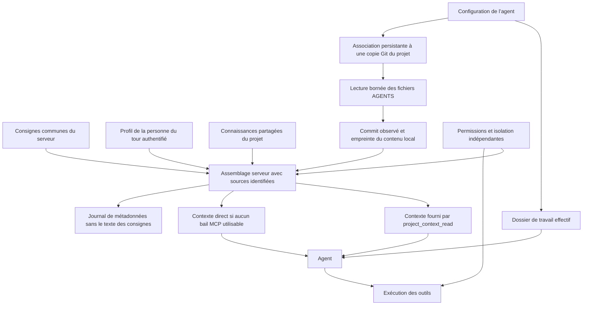
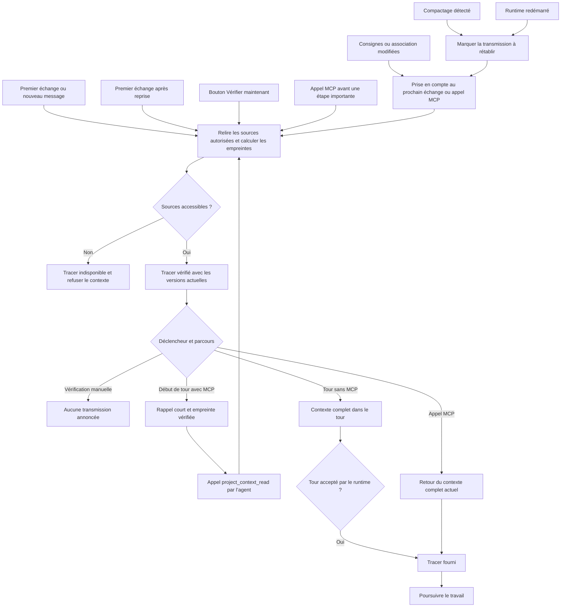

# Consignes des agents : profil, projet et source Git

## Paramétrage

Les consignes sont assemblées pour un agent sans déplacer son dossier de travail :

| Source  | Emplacement dans l’interface                                                                       | Portée                                                         |
| ------- | -------------------------------------------------------------------------------------------------- | -------------------------------------------------------------- |
| Serveur | Paramètres → Codex → Instructions                                                                  | Consignes communes de l’instance                               |
| Profil  | Mon profil → Préférences des agents                                                                | Préférences de l’utilisateur authentifié qui demande l’échange |
| Projet  | Paramètres du projet → Gestion des agents → Connaissances partagées                                | AGENTS.md, CONNAISSANCES.md et DECISIONS.md propres au projet  |
| Git     | Sidebar droite de l’agent → Sources → menu du dépôt → Utiliser une copie comme source de consignes | Une copie Git locale explicitement associée à cet agent        |

Le profil permet de choisir une langue de réponse et un texte personnel, limité
à 8 000 octets UTF-8. Ce texte est fourni à l’agent : ne pas y placer de secrets.
Dans un agent partagé, les préférences sont celles de la personne à l’origine du
tour authentifié, pas celles du dernier visiteur. Les automatismes utilisent leur
identité d’exécution existante ; une identité de service sans profil n’emprunte
pas les préférences d’une personne.

La fenêtre **Consignes de cet agent** propose les copies Git prêtes et accessibles
du projet, leur association ou son retrait, l’aperçu du fichier racine actuel,
les sources et leurs empreintes, et le journal. La modification d’association est
réservée à l’administrateur, comme les paramètres d’exécution des agents. Une
version attendue empêche d’écraser silencieusement une modification simultanée.
Les variantes d’un même agent partagent l’association de leur agent racine.

Une copie servant aux consignes peut différer de celle réservée à l’agent pour
les écritures. Cette association ne réserve pas la copie, n’accorde aucun droit
sur ses fichiers et ne modifie pas la référence de travail.

## Deux AGENTS.md distincts

Le fichier des connaissances partagées est conservé par Mergeron dans l’espace
système du projet. Celui du dépôt suit sa copie locale et sa révision Git. Aucun
contenu n’est synchronisé, copié ou écrasé entre ces deux sources.

Le serveur lit le contenu réel de la copie choisie, y compris les modifications
non committées. Vérifier les consignes ne déclenche ni fetch ni pull : actualiser
la copie Git reste une opération explicite. Il conserve dans le journal les chemins relatifs fournis, le
commit observé et l’empreinte du contenu ; le commit seul ne prouve pas qu’un
fichier local est inchangé. L’aperçu montre le contenu actuel, qui peut différer
de celui d’un ancien échange.

Dans un même dossier, AGENTS.override.md est prioritaire sur AGENTS.md. La lecture
racine est obligatoire pour une source associée. Les instructions cumulées sont
limitées à 32 Kio par lecture ; elles ne sont pas tronquées silencieusement.
Les liens symboliques, fichiers spéciaux et fichiers liés en dur sont refusés.
Sur Linux, la lecture épingle les descripteurs de dossiers pour empêcher une
substitution de chemin pendant le parcours.

Les fichiers spécialisés ne sont pas tous chargés d’emblée. Avant une intervention
dans un domaine, l’agent peut demander par exemple :

```json
{ "instructionDirectory": "web" }
```

à `project_context_read`. Le serveur lit uniquement les fichiers AGENTS de la
racine jusqu’à ce dossier, dans la copie déjà associée. Ni autre projet, ni autre
copie, ni nom de fichier arbitraire ne peut être choisi par cet argument. Le chemin
relatif a une profondeur maximale de huit dossiers. Les consignes spécialisées
gardent leur portée : celles de web ne deviennent pas des règles de déploiement.

Si Codex a déjà chargé nativement les mêmes fichiers depuis son dossier de
travail, le contexte lui demande de conserver leur portée et d’éviter une
relecture inutile. Mergeron ne dispose pas d’une preuve de ce chargement natif ;
le journal suit uniquement ce que Mergeron vérifie et transmet lui-même.

## Assemblage technique



Les préférences et consignes ne sont pas un mécanisme d’autorisation. Elles ne
peuvent pas désactiver les contrôles de projet, le sandbox, l’approbation des
outils ou les règles de publication versionnée. Une contradiction avec ces
contrôles ne doit pas être résolue en les contournant.

## Déclenchement et rafraîchissement



Chaque début de tour relit les sources côté serveur. Un bail MCP utilisable
conserve le rappel court ; le contenu complet est relu lors de l’appel MCP.
Sans bail MCP utilisable, les consignes sont directement incluses et le reçu
n’est enregistré qu’après acceptation du tour par le runtime. Un refus de
démarrage n’est pas une transmission réussie.

Le contexte retourné est complet même si son empreinte est identique à celle
d’un échange précédent. Cette retransmission permet de rétablir les règles après
compactage. Une section vide ou une association retirée remplace explicitement
son ancienne version. Il ne s’agit pas d’un cache qui suppose que le modèle a
encore conservé le contenu en mémoire.

Le compactage observé marque le contexte à rétablir ; il n’injecte pas de message
au milieu d’un outil en cours. Le rappel demande une relecture après compactage
et avant une étape importante. Si le runtime ne signale pas le compactage, le
prochain échange reste vérifié et le prochain appel MCP renvoie le contexte.
Il n’existe pas ici de minuterie garantissant qu’un agent appellera MCP pendant
une longue exécution : imposer ce contrôle à chaque étape nécessiterait une
interception supplémentaire du runtime.

Une source Git associée devenue inaccessible bloque le nouveau tour ou le
rafraîchissement. Mergeron ne remplace pas silencieusement ses consignes par une
ancienne copie. Rétablir l’accès ou retirer explicitement l’association permet
de reprendre. Une modification pendant un tour ne force pas son interruption.

## Lire les états

- **Vérifié, pas encore fourni** : le serveur a lu les sources ; le bouton manuel
  n’a rien envoyé au modèle.
- **Fourni à l’agent** : le contexte a été remis au runtime ou retourné par MCP.
  Cela ne prouve pas une lecture attentive ou un respect des consignes.
- **À fournir ou à rétablir** : association modifiée, session redémarrée ou
  compactage observé ; attendre un nouveau tour ou un appel MCP.
- **Contexte indisponible** : une source requise n’a pas pu être lue ; le contexte
  n’a pas été fourni.

Les dates et empreintes concernent la vérification ou la transmission indiquée,
pas une surveillance continue du disque. Le journal conserve les 50 derniers
événements par conversation et l’interface en présente les 20 plus récents. Il
ne conserve ni le texte Git, ni les préférences personnelles. Les sources de
profil ne sont pas un écran permettant de lire les préférences d’un autre membre.

La migration 0080 ajoute des tables sans supprimer de données existantes. Les
profils et associations sont persistants dans la base et ses sauvegardes. Les
nouvelles associations ne sont pas transportées par l’export ZIP de projet : les
identifiants des copies doivent être choisis à nouveau après import. Aucun
paramètre Docker, réseau, de production ou variable d’environnement n’est modifié.

Voir [Contexte et outils MCP](contexte-et-outils-agents.md),
[Administration Codex](administration-codex.md) et
[Développement du dépôt](../CONTRIBUTING.md).
